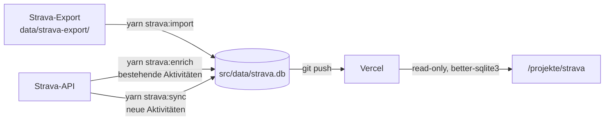

# Projekte – Strava-Dashboard

Dashboard unter `/projekte/strava` mit allen Strava-Aktivitäten: Filter nach Jahr, Typ (inkl. Strava-Sportart wie „Gravel Ride“), Ausrüstung, Gerät und Tag, Sortierung, Summen, Details und Direktlink zu Strava. Datenbasis ist die SQLite-Datenbank `src/data/strava.db`, die aus dem Strava-Datenexport erzeugt und über die Strava-API ergänzt wird.

| Thema | Doku |
| ----- | ---- |
| Export herunterladen und importieren | [Export-Import.md](Export-Import.md) |
| Strava-API: Einrichtung, Enrichment, Sync, Rate-Limits | [Strava-API.md](Strava-API.md) |
| Automatischer Sync per GitHub Action (geplant) | [GitHub-Action.md](GitHub-Action.md) |

## Spickzettel

**Neue Aktivitäten holen (regelmäßig):**

```bash
git pull                     # strava.db ist binär – Konflikte vermeiden
yarn strava:sync --dry-run   # zeigt, was neu ist
yarn strava:sync
git add src/data/strava.db && git commit -m "chore: update strava activities" && git push
```

**Ältere Aktivitäten mit API-Daten anreichern** (Gerät, Tags, Strava-Sportart):

```bash
yarn strava:enrich           # wartet automatisch an Rate-Limits, Ctrl+C jederzeit möglich
```

**Neuer Export (alle paar Monate, liefert Wetter, Training Load usw.):**

```bash
yarn strava:import --dry-run --only-new
yarn strava:import --only-new
```

**Fehler „Keine Strava-Tokens gefunden“ oder „Token-Anfrage fehlgeschlagen“:** `yarn strava:auth` erneut ausführen.

## Wichtig zu wissen

- **Export vs. API:** Der Export liefert die meisten Metriken (Wetter, Training Load, Schritte, Dateiname …), aber kein Gerät, keine Tags und nur die grobe Sportart (`Ride` statt `GravelRide`). Die API liefert genau diese Zusatzinfos. Beide ergänzen sich in derselben Tabelle.
- **`strava:enrich` vs. `strava:sync`:** `enrich` bearbeitet nur Aktivitäten, die *schon in der DB* sind (neueste zuerst). Aktivitäten nach dem letzten Export kennt die DB nicht – die holt `sync`. Reihenfolge: erst `sync`, dann `enrich`.
- **Abbrechen und fortsetzen:** Jede Aktivität wird sofort gespeichert. Nach Ctrl+C setzt ein erneuter Aufruf genau dort fort (es werden nur Aktivitäten mit `api_synced_at IS NULL` abgerufen).
- **Rate-Limits:** ca. 100 Requests je 15 min, 1000 pro Tag. Am 15-min-Limit wartet das Skript bis zum nächsten Fenster (:00/:15/:30/:45) und läuft dann automatisch weiter. Am Tageslimit beendet es sich (Reset 00:00 UTC = 01:00 bzw. 02:00 Uhr deutscher Zeit). Der erste komplette `enrich`-Lauf über ~2000 Aktivitäten dauert ca. 2 Tage.
- **`sport_type` vs. `api_sport_type`:** `sport_type` enthält immer den Export-Namen (z. B. `Ride`), damit „Radfahren“-Filter und Charts für alle Zeilen gleich funktionieren. Die genaue Strava-Sportart (`GravelRide`, `MountainBikeRide`, `TrailRun` …) steht zusätzlich in `api_sport_type` und erscheint im Typ-Filter unter „Strava-Sportart“, in den Details und in der Typ-Spalte der Tabelle (dort statt `sport_type`, z. B. „Gravel Ride“ statt „Ride“; die Sortierung nach Typ folgt dieser Anzeige). In den „Summen pro Sportart“ und auf der Charts-Seite hat „Gravel Ride“ eine eigene Zeile bzw. ein eigenes Diagramm direkt nach „Ride“; diese Fahrten fehlen dafür in „Ride“, „Radfahren (gesamt)“ bleibt gleich. Weitere Sportarten dafür kommen in `TOTALS_SUBTYPES` (`src/lib/strava/sport-types.ts`).
- **Erneuter Export-Import** überschreibt die API-Spalten nie. `--only-new` ersetzt per Sync angelegte Zeilen (`source = 'api'`) durch die vollständigeren Export-Daten.
- **Secrets:** `data/strava-export/` und `data/strava-tokens.json` sind in der `.gitignore` und dürfen nie committet werden. `src/data/strava.db` dagegen **muss** eingecheckt werden (Repo ist privat).

## Datenfluss



Die Seite wird pro Request gerendert (wegen des Login-Cookies) und liest die DB read-only. `next.config.js` liefert die DB per `outputFileTracingIncludes` mit der Serverless-Funktion aus.

## Datenmodell

- Typen: `src/types/strava.ts`, Schema: `src/lib/strava/schema.ts`.
- Tabelle `activities`, Primärschlüssel ist die Strava-Aktivitäts-ID.
- Einheiten wie in der Strava-API: Distanz/Höhe in Metern, Zeiten in Sekunden, Geschwindigkeiten in m/s, `start_date` als ISO-String (UTC).
- Spaltennamen folgen der Strava-API (`sport_type`, `moving_time`, `total_elevation_gain` …).
- `source` (`export` | `api`) zeigt, ob eine Zeile aus dem Export oder aus `strava:sync` stammt.
- **Metriken** (Höhe, Steigung, Trittfrequenz, Leistung, Belastung, Wetter, Laufwerte, Gewicht) stehen zentral in `ACTIVITY_METRIC_COLUMNS`. Neue Felder dort und in `METRIC_SOURCES` (`scripts/import-strava.ts`) eintragen und `yarn strava:import` erneut ausführen – fehlende Spalten werden automatisch per `ALTER TABLE` ergänzt.
- **API-Spalten** stehen in `ACTIVITY_API_COLUMNS` und werden nur von `strava:enrich`/`strava:sync` geschrieben:

  | Spalte | Inhalt |
  | ------ | ------ |
  | `api_sport_type` | Genaue Strava-Sportart, z. B. `GravelRide` |
  | `device_name` | Gerät, z. B. „Garmin Edge 840“, „Zwift“, „Strava App“ |
  | `workout_type` | Run: 0 Standard, 1 Wettkampf, 2 Langer Lauf, 3 Training · Ride: 10 Standard, 11 Rennen, 12 Training |
  | `trainer` | 1 = Indoor/Rolle |
  | `visibility` | `everyone` / `followers_only` / `only_me` |
  | `external_id` | Original-Dateiname vom Gerät/Upload |
  | `gear_id`, `start_date_local`, `timezone` | wie in der API |
  | `api_synced_at` | Zeitpunkt des letzten Detail-Abrufs (UTC); `NULL` = noch nicht angereichert |
  | `api_status` | `ok` oder `not_found` (gelöscht/kein Zugriff) |

- **Tags** (Wettkampf/Rennen, Langer Lauf, Training, Indoor, Pendeln) leitet `src/lib/strava/activity-tags.ts` aus `workout_type`, `trainer` und `commute` ab.
- Nicht übernommen: private Notizen, GPS-/FIT-Dateien, Karten/Strecken sowie im Export immer leere Spalten (`Max Watts`, `Max Temperature`, `Newly Explored Distance`).

Daten direkt ansehen:

```bash
node -e "const D=require('better-sqlite3');const db=new D('src/data/strava.db',{readonly:true});console.log(db.prepare('SELECT MAX(start_date) AS newest, COUNT(*) AS total, SUM(api_synced_at IS NULL) AS not_enriched FROM activities').get())"
```

## Dashboard & Passwortschutz

Öffentlich sichtbar sind nur die vier Gesamtsummen (Aktivitäten, Distanz, Höhenmeter, Bewegungszeit). Liste, Filter, Details und gefilterte Summen erscheinen erst nach Login; ohne gültige Session werden diese Daten serverseitig gar nicht geladen (`getDashboardData()` prüft die Session selbst).

Nach dem Login lädt der Server nur die Aktivitäten des gewählten Jahres. URL-Parameter:

| Parameter | Beispiel | Hinweis |
| --------- | -------- | ------- |
| `year` | `2024`, `all` | lädt Daten vom Server nach; Standard: aktuelles Jahr |
| `type` | `Ride`, `cycling`, `all`, `strava:GravelRide` | Standard: `cycling` (Ride, E-Bike Ride, Virtual Ride) |
| `gear` | Name, `none` | `none` = ohne Ausrüstung |
| `device` | `Zwift`, `none` | `none` = Gerät unbekannt (noch nicht angereichert) |
| `tag` | `race`, `long-run`, `workout`, `indoor`, `commute` | nur Tags, die im Jahr vorkommen |
| `sort` | `distance-desc` | |

Alles außer `year` wird clientseitig angewendet.

Benötigte Variablen in `.env.local` und auf Vercel (**Settings → Environment Variables**):

```env
# Langes Zufallspasswort, z. B. `openssl rand -base64 24`
STRAVA_DASHBOARD_PASSWORD="..."
# Mindestens 32 Zeichen, z. B. `openssl rand -base64 48`
STRAVA_SESSION_SECRET="..."
```

- Nicht verwechseln: `STRAVA_SESSION_SECRET` gehört zum Dashboard-Login, `STRAVA_CLIENT_SECRET` zur Strava-API.
- Session-Cookie `strava_session`: `httpOnly`, `secure` (Produktion), `sameSite=lax`, Pfad `/projekte/strava`, 30 Tage gültig, HMAC-signiert.
- Alle Sessions ungültig machen: `STRAVA_SESSION_SECRET` ändern und neu deployen.
- Schutz gegen Brute-Force: Honeypot-Feld, 1 s Verzögerung bei Fehlversuchen, max. 5 Fehlversuche pro IP in 15 Minuten (pro Server-Instanz, daher nur Zusatzschutz), zeitkonstanter Passwortvergleich. Der eigentliche Schutz ist ein langes Zufallspasswort.
- Fehlen die Variablen, schlägt jeder Login fehl (Fehler im Server-Log), die öffentlichen Summen bleiben sichtbar.
- Die Seite ist zusätzlich nicht verlinkt, nicht in der Sitemap und `noindex`.

## Relevante Dateien

| Datei | Zweck |
| ----- | ----- |
| `scripts/import-strava.ts` | CSV-Import (`yarn strava:import`) |
| `scripts/strava-auth.ts`, `strava-enrich.ts`, `strava-sync.ts` | Strava-API: OAuth, Enrichment, Sync |
| `scripts/lib/strava-api/` | API-Client (Tokens, Rate-Limits), Mapping API → DB, Schema-Migration |
| `src/lib/strava/schema.ts` | Tabellen-DDL und Spaltendefinitionen |
| `src/lib/strava/sport-types.ts` | Sport-Typen, Reihenfolge, Mapping API-Sportart → Export-Name |
| `src/lib/strava/activity-tags.ts` | Tags aus `workout_type`, `trainer`, `commute` |
| `src/lib/strava/db.ts` | Read-only Zugriff auf die DB |
| `src/lib/strava/auth.ts`, `session.ts` | Dashboard-Login (Passwort, Session) |
| `src/app/projekte/strava/page.tsx` | Seite (öffentliche Summen, Login oder Dashboard) |
| `src/app/projekte/strava/actions.ts` | Server Actions für Login/Logout inkl. Honeypot und Rate-Limit |
| `src/app/projekte/strava/charts/` | Charts |
| `src/proxy.ts` | Leitet Unterseiten `/projekte/strava/*` ohne Session auf die Login-Seite um |
| `src/components/projects/strava/strava-dashboard.tsx` | Client-UI mit Filtern und Tabelle |
| `src/components/projects/strava/strava-totals-overview.tsx` | Öffentliche Gesamtsummen |
| `src/components/projects/strava/strava-login-form.tsx` | Login-Formular |
| `next.config.js` | `outputFileTracingIncludes` liefert die DB mit aus |
